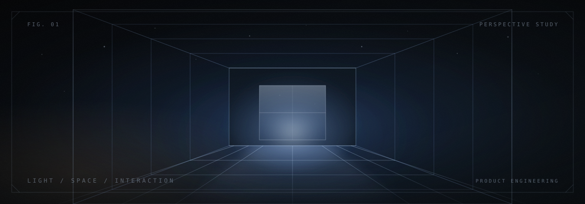

# sarvio

**产品工程师**

图形与交互 · AI 应用 · Web 与移动端

<a href="./README.md">English</a> · <a href="./README.zh-CN.md">简体中文</a> · <a href="./README.ja.md">日本語</a>

## 关于

我开发 Web 和移动端产品，涉及交互图形与 AI 应用。工作涵盖 WebGL 与 GLSL 渲染、前端界面和后端服务。

## 技术栈

- **图形** · WebGL、GLSL、Three.js、C++、OpenSceneGraph、SceneKit
- **Web** · TypeScript、React、Next.js、Vue、Nuxt、Vite
- **移动与桌面端** · Dart、Flutter、Swift、SwiftUI、Electron
- **后端** · Node.js、NestJS、Python、FastAPI
- **数据** · MySQL、PostgreSQL、Supabase、SQLite
- **工具** · Git、Docker、GitHub Actions

## 项目方向

### 图形与交互工具

房间与商品可视化、画布界面和几何编辑工具，涉及可复用渲染模块与 SDK 集成。

### AI 应用

集成大语言模型的对话产品，涵盖流式响应、记忆摘要与订阅流程。

### Web 与跨端产品

Web 应用、管理界面、Flutter 客户端与原生 SwiftUI 应用，以及配套的 API、身份认证和数据存储。

## 近期

正在探索 AI 辅助的前端可视化，着重交互、渲染效果与性能。

## 联系

[mmmmmomo173@gmail.com](mailto:mmmmmomo173@gmail.com)
